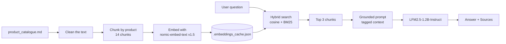

# Brightmere Energy Product Q&A Agent

A command-line agent that answers questions about the Brightmere Energy product catalogue (`product_catalogue.md`) using **only what the catalogue says**. It finds the catalogue sections that match a question and asks a local chat model to answer from those sections alone. This approach is called retrieval-augmented generation (RAG).

Both AI models run locally in **LM Studio**. No cloud AI or cloud database is used.

```text
$ python qa_agent.py
Loaded 14 product sections from product_catalogue.md

> How many battery modules does the AMPERIS HYBRID 2 support?
Agent: The AMPERIS HYBRID 2 supports 3 to 10 stackable battery modules.
Sources: AMPERIS HYBRID 2

> exit
Goodbye.
```

---

## Contents

1. [Pipeline](#pipeline)
2. [Project structure](#project-structure)
3. [Setup](#setup)
4. [How to run](#how-to-run)
5. [Configuration](#configuration)
6. [Cleaning the catalogue](#cleaning-the-catalogue)
7. [Chunking strategy and why](#chunking-strategy-and-why)
8. [Embeddings and caching](#embeddings-and-caching)
9. [Retrieval](#retrieval)
10. [Grounded answers](#grounded-answers)
11. [Evaluation](#evaluation)
12. [Known limitations](#known-limitations)
13. [Troubleshooting](#troubleshooting)

---

## Pipeline



The same pipeline as plain text:

```text
product_catalogue.md
        │
        ▼  1. Clean: remove page comments and image tags, fix PDF conversion typos
        │
        ▼  2. Chunk: one chunk per product (### heading), with its category
        │     and the category's shared features attached → 14 chunks
        │
        ▼  3. Embed once with nomic-embed-text v1.5 → cache to .embeddings_cache.json
        │
question ─▶  4. Hybrid search: cosine similarity (meaning) + BM25 (exact words)
        │     → top 3 chunks, products named in the question first
        │
        ▼  5. Grounded prompt: every context line tagged with its product,
        │     catalogue date (March 2026), strict rules, temperature 0
        │
        ▼  6. LFM2.5-1.2B-Instruct writes the answer
        │
        ▼
  Answer + the product sections it came from
```

**Indexing** (steps 1–3) runs once at startup; the embeddings are cached, so later starts are fast. **Answering** (steps 4–6) runs for every question.

---

## Project structure

```text
Product-Q-A-Agent/
├── qa_agent.py              # The agent: the single entry point
├── product_catalogue.md     # Knowledge base (kept exactly as received)
├── requirements.txt         # Python dependencies
├── README.md                # This file
├── eval_output.txt          # Output of: python qa_agent.py --eval
├── .gitignore               # Ignores the virtual environment and the embedding cache
│
├── .venv/                   # (not in Git) virtual environment
└── .embeddings_cache.json   # (not in Git) created on first run
```

Inside `qa_agent.py`, the code follows the pipeline order:

| Section | Main functions | Requirements |
|---|---|---|
| Settings | `SETTINGS`, `TEST_QUERIES`, `PDF_FIXES`, `STOPWORDS` | Settings in one place |
| 1. Ingestion and chunking | `clean_markdown`, `parse_and_chunk_catalogue` | R1, R2 |
| 2. Embeddings and cache | `embed_texts`, `load_or_create_embeddings` | R3 |
| 3. Hybrid retrieval | `tokenize`, `compute_bm25_scores`, `retrieve_chunks`, `find_named_products` | R4, R11 |
| 4. Grounded answers | `build_tagged_context`, `generate_grounded_answer` | R5, R6, R7 |
| 5. Command line | `print_chunks`, `run_eval`, `run_interactive`, `main` | R8, R9, R10, R11 |

---

## Setup

### Requirements

- **Python 3.10 or newer**
- **LM Studio** with its local server enabled

### 1. Set up LM Studio

1. In LM Studio, download the embedding model: search for **nomic-embed-text v1.5**.
2. Make sure you have the chat model **LFM2.5-1.2B-Instruct**.
3. Load **both** models.
4. Start the local server (default address `http://localhost:1234`).
5. Check the exact model names LM Studio shows. If they differ from the defaults in [Configuration](#configuration), update them.

### 2. Get the code

```bash
git clone <your-repo-url>
cd Product-Q-A-Agent
```

### 3. Create a virtual environment and install dependencies

**Windows (PowerShell):**

```powershell
python -m venv .venv
.\.venv\Scripts\Activate.ps1
python -m pip install -r requirements.txt
```

If PowerShell says *"running scripts is disabled on this system"*, run this once and try again:

```powershell
Set-ExecutionPolicy -Scope CurrentUser RemoteSigned
```

**macOS / Linux:**

```bash
python3 -m venv .venv
source .venv/bin/activate
python -m pip install -r requirements.txt
```

When the environment is active, your prompt starts with `(.venv)`.

### 4. Check that it works

```bash
python qa_agent.py --chunks
```

This needs no models. It should print `Loaded 14 product sections from product_catalogue.md` followed by the 14 chunks.

---

## How to run

Run every command from the project folder, with the virtual environment active.

| Command | What it does | Needs LM Studio |
|---|---|---|
| `python qa_agent.py` | Starts the question loop | Yes |
| `python qa_agent.py --chunks` | Prints every chunk the agent built, then exits | No |
| `python qa_agent.py --eval` | Runs the 7 test queries; prints the sections retrieved and the answer for each | Yes |
| `python qa_agent.py --debug` | Question loop that also prints the similarity scores of each retrieved chunk | Yes |
| `python qa_agent.py --eval --debug` | The 7 test queries, with similarity scores | Yes |
| `python qa_agent.py --help` | Lists the options | No |

In the question loop, type `exit` or `quit` (or press Ctrl+C) to end the session.

`--chunks` takes priority: if combined with other options, it only prints the chunks.

### Saving the evaluation output

**Windows (PowerShell):**

```powershell
python qa_agent.py --eval | Out-File -Encoding utf8 eval_output.txt
```

> Don't use `>` in Windows PowerShell 5.1: it saves the file as UTF-16, which displays as garbled text on GitHub.

**macOS / Linux:**

```bash
python qa_agent.py --eval > eval_output.txt
```

### Example `--debug` output

```text
> Does the GRIDWATCH AI use clamp-on CT sensors?
[DEBUG] Top retrieved chunks:
  - GRIDWATCH AI: hybrid=... (cosine=..., bm25=...)
  - GRIDWATCH PULSE: hybrid=... (cosine=..., bm25=...)
  - ...
Agent: ...
Sources: GRIDWATCH AI
```

---

## Configuration

All settings are in the `SETTINGS` block at the top of `qa_agent.py`.

| Setting | Default | Meaning |
|---|---|---|
| `LM_STUDIO_BASE_URL` | `http://localhost:1234/v1` | LM Studio server address |
| `LM_STUDIO_API_KEY` | `lm-studio` | Placeholder; LM Studio doesn't check it |
| `EMBEDDING_MODEL` | `text-embedding-nomic-embed-text-v1.5` | Embedding model name in LM Studio |
| `CHAT_MODEL` | `lfm2.5-1.2b-instruct` | Chat model name in LM Studio |
| `CATALOGUE_PATH` | `product_catalogue.md` | Knowledge base file |
| `CACHE_PATH` | `.embeddings_cache.json` | Embedding cache file |
| `TOP_K` | `3` | Number of chunks passed to the chat model |
| `HYBRID_ALPHA` | `0.65` | Weight of cosine similarity in the hybrid score (BM25 gets `1 − 0.65`) |
| `MIN_RELEVANCE_SCORE` | `0.35` | If the best chunk's cosine score is below this, the agent says it can't find the answer without calling the chat model |

The first four can also be set as environment variables, without editing the code:

```powershell
$env:CHAT_MODEL = "your-model-name"
python qa_agent.py
```

---

## Cleaning the catalogue

The catalogue was converted from a PDF, and the conversion left noise and errors. The file itself is **never edited**: `clean_markdown()` cleans the text in memory at startup, so the original stays the source of truth and the same cleaning runs every time.

| Problem in the file | Example | Fix | Why it matters |
|---|---|---|---|
| Page and image comments | `<!-- page:2 -->`, `<!-- image_id:... -->` | Removed | Meaningless text in chunks, embeddings and BM25 |
| Image tags | `` | Removed | Same |
| Lost "ff" ligature from the PDF conversion | `eficiency`, `ofering`, `Of-Grid`, `Ofline`, `diferences` | Corrected using the `PDF_FIXES` table | BM25 matches exact words: a question about "efficiency" would never match "eficiency" |
| Typo | `settings an batteries` | → `settings and batteries` | Cleaner answers |
| Tabs, including inside text | `Optimized⇥battery⇥life` | Replaced with single spaces | Clean chunk text |
| Mixed bullet styles | `•`, `•⇥` | All become `- ` | Consistent chunks |
| A category heading without `##` | `Handheld Solar Test Tools` | Treated as a category by the parser | Otherwise the three ARRAYCHECK products get the wrong category |
| Extra blank lines | | Collapsed | Tidy `--chunks` output |

The `PDF_FIXES` table was built by reading the whole catalogue. It is specific to this file; a new catalogue would need its own check.

---

## Chunking strategy and why

**Strategy: one chunk per product, split on the `###` headings. This gives 14 chunks for 14 products.**

Each chunk contains:

1. The product's **category** (the `##` heading above it)
2. The category's **shared features**, if the category has any
3. The product's **name, tagline and bullets**

Example (`python qa_agent.py --chunks`):

```text
[Chunk 11] GRIDWATCH AI (Category: Permanent Plant Monitoring)
------------------------------------------------------------
Category: Permanent Plant Monitoring

Category Overview & Shared Features:
Compact, permanently installed monitoring gateways featuring built-in 4G data communication ...
- 97% connectivity rate from inside metal electrical cabinets to the cloud
- No drilling or cutting required, magnetic mounting even on steel cabinet doors
...

Product: GRIDWATCH AI
Monitoring gateway featuring internal current sensing and AI cloud analytics
- Ultra compact single casing design
- No need for additional external sensors or clamp cables
...
```

### Why this boundary

- **The catalogue is already organised by product.** Every product starts with a `###` heading followed by a short spec list, so the document's own structure gives clean, reliable boundaries.
- **Each product is one complete unit.** Products are short (roughly 25–100 words each), so one chunk holds everything about a product, and a product's name is never separated from its features.
- **Answers must cite products (R9).** With one chunk per product, the source of every retrieved chunk is simply its product name.
- **Questions are about products.** Most questions ask about one product, compare products, or look for a product that fits a need. Whole-product chunks match all three.

### Why the shared category features are attached

Under `## Permanent Plant Monitoring`, five shared bullets sit **above** both `### GRIDWATCH AI` and `### GRIDWATCH PULSE`, including *"97% connectivity rate from inside metal electrical cabinets"* and *"No drilling or cutting required, magnetic mounting even on steel cabinet doors"*. A plain split on `###` would drop them, and test query 5 (*"permanent monitoring inside steel electrical cabinets with no drilling"*) could not be answered. The parser keeps any text between a `##` heading and its first `###` and adds it to every product in that category.

### Why the category name is attached

The category helps match broad questions to the right type of product. For example, *"large commercial rooftop with long cable runs"* also matches the ARRAYCHECK 550 thermal camera, which is "for large commercial rooftops". The inverter category and "long cable runs" point to the SOLVANTA 15K.

### Alternatives considered

| Approach | Why not used |
|---|---|
| **Semantic chunking** (cut where sentence meaning changes) | Built for long, unstructured prose. Here the boundaries already exist; guessing them from embeddings could split a product or merge two products. |
| **Fixed-size chunks** (e.g. every 100 words) | Would cut through products and separate features from product names. |
| **One chunk per bullet** (~80 chunks) | A bullet like "Batteries replaceable in the field" matches several products equally, and comparisons would need many chunks. |

---

## Embeddings and caching

- **Model:** nomic-embed-text v1.5, run in LM Studio and called with `client.embeddings.create`.
- **Task prefixes:** nomic is trained with prefixes, so chunks are embedded as `search_document: <chunk>` and questions as `search_query: <question>`. Leaving them out lowers retrieval quality.
- **Caching:** the 14 chunk vectors are saved to `.embeddings_cache.json` with a **hash of the chunk text and the model name**. On startup, if the hash matches, the vectors are loaded from the file and no embedding calls are made. If the cleaning, the chunking or the model changes, the hash changes and the chunks are re-embedded automatically, so the cache is never out of date.
- **Why a file and not a vector database:** with only 14 chunks, comparing a question with every chunk in numpy is instant. A local JSON file keeps the project simple and adds no dependencies.

The cache file is listed in `.gitignore`, as the brief requires.

---

## Retrieval

Each question is matched against all 14 chunks using **hybrid search**: two scores, combined.

| Score | Computed by | Good at |
|---|---|---|
| **Cosine similarity** | numpy, on the nomic vectors | Meaning: finds the right product when the question uses its own words (e.g. "no drilling" → magnetic mounting) |
| **BM25 keyword score** | A small BM25 implementation in `compute_bm25_scores` | Exact words: product names (`SOLVANTA 5K PRO`), abbreviations (`DSM`), feature names (`Insulation Trend Memory`) |

### Combining the scores

```text
hybrid score = 0.65 × cosine similarity + 0.35 × BM25 score
```

BM25 scores are divided by the highest BM25 score for that question, so both scores fall between 0 and 1 before they are combined. Meaning carries more weight, because many questions describe a need rather than naming a product. BM25 still lifts chunks that contain the question's exact names and terms.

### Stopwords

Common words such as *the*, *is*, *what* and *of* are ignored by BM25. Without this, an unrelated question can get a high keyword score from common words alone; for example, "What is the price of a Tesla Powerwall?" gave the ARRAYCHECK 3 tester the top BM25 score. With stopwords removed, that question scores 0 on every chunk.

### Products named in the question come first

If the question names a product exactly (for example *"Does the **GRIDWATCH AI** use clamp-on CT sensors?"*), that product's chunk is placed first in the results. Without this, GRIDWATCH PULSE ranks first for that question, because it is the product that mentions "clamp-on CT sensors", which makes it easier for the model to confuse the two.

### Top-k = 3

The 3 highest-scoring chunks are passed to the chat model.

- Several questions need **two** products: comparisons (query 2), feature traces (query 3), the two GRIDWATCH products (queries 5 and 7). The right product is not always ranked first, so 3 leaves a margin.
- **More is not better.** With only 14 chunks, 3 is already about a fifth of the catalogue. Extra unrelated products in the prompt make a small model more likely to mix up facts between products.

---

## Grounded answers

The agent must answer **only from the catalogue (R6)** and **say plainly when the catalogue has no answer (R7)**. This is done in four ways.

1. **A relevance check before the model is called.** If the best chunk's cosine score is below `MIN_RELEVANCE_SCORE`, the agent replies *"I cannot find that information in the Brightmere Energy product catalogue."* without calling the chat model.

2. **Every context line is tagged with its product.** `build_tagged_context()` labels each line, so the model can see which product every fact belongs to:

   ```text
   --- PRODUCT SECTION: GRIDWATCH AI ---
   Category: Permanent Plant Monitoring
   [Shared: Permanent Plant Monitoring] - No drilling or cutting required, magnetic mounting ...
   [GRIDWATCH AI] - No need for additional external sensors or clamp cables
   ```

3. **A strict system prompt.** The rules tell the model to:
   - use only facts written in the context, without adding comparisons or judgements;
   - attribute each fact only to the product in its tag, and treat `[Shared: ...]` lines as applying to the whole category;
   - check the asked-about product's own lines for yes/no questions;
   - report launch dates or availability and say they come from the **March 2026** catalogue;
   - reply with the exact "cannot find" sentence only if nothing in the context is relevant.

4. **Temperature 0**, so the model gives its most likely answer rather than a creative one.

### Knowledge cutoff and document date

The catalogue is a snapshot from **March 2026**, not today. For example, it says GRIDWATCH PULSE is *"Launching Q1 2027"*. The agent should report this as what the March 2026 catalogue says, not as current availability.

### Sources (R9)

After each answer, the agent prints the products the answer came from. These are the retrieved products whose names appear in the answer; if none are named, all retrieved products are listed. When the agent can't find an answer, it prints `Sources: None`.

---

## Evaluation

`python qa_agent.py --eval` runs the seven test queries from the brief and prints, for each, the **sections retrieved** and the **answer**. The full output is saved in [`eval_output.txt`](eval_output.txt).

| # | Query | Type | Product(s) needed |
|---|---|---|---|
| 1 | What is the Insulation Trend Memory feature and which product has it? | Direct feature lookup | ARRAYCHECK 3 |
| 2 | What is the difference between the SOLVANTA 3K and the SOLVANTA 5K PRO? | Product comparison | SOLVANTA 3K, SOLVANTA 5K PRO |
| 3 | Which products use Dual-Sense MPPT (DSM), and what advantage does DSM give? | Multi-product feature trace | SOLVANTA 5K PRO, SOLVANTA 15K |
| 4 | We are installing panels on a large commercial rooftop with long cable runs. What do you recommend? | Implicit recommendation | SOLVANTA 15K |
| 5 | We want permanent monitoring inside steel electrical cabinets with no drilling. What fits? | Implicit recommendation | GRIDWATCH AI, GRIDWATCH PULSE |
| 6 | Can I buy the GRIDWATCH PULSE today? | Hallucination probe | GRIDWATCH PULSE |
| 7 | Does the GRIDWATCH AI use clamp-on CT sensors? | Hallucination probe | GRIDWATCH AI |

### How a wrong answer is diagnosed

Retrieval and generation are checked **separately**, because `--eval` prints the retrieved sections before each answer:

- **The needed product is missing from "Retrieved sections"** → a retrieval problem (cleaning, chunking, scoring or top-k).
- **The needed product was retrieved but the answer is wrong** → a generation problem (prompt, context format or the chat model).

`--debug` adds the cosine, BM25 and hybrid score of each retrieved chunk, which shows *why* a chunk was or wasn't retrieved.

### Expected behaviour on the hallucination probes

- **Query 6:** the catalogue says GRIDWATCH PULSE is *launching Q1 2027*, with pilot units available from dealers. A correct answer reports this as of the March 2026 catalogue and does not claim it can be bought today.
- **Query 7:** the answer is **no**. GRIDWATCH AI uses *internal current sensing* and needs *"no additional external sensors or clamp cables"*. Clamp-on CT sensors belong to GRIDWATCH PULSE.

---

## Known limitations

- **Small chat model.** LFM2.5-1.2B-Instruct can still attribute a feature to the wrong product or add claims not in the context, even with tagged context and strict rules. Where this happens, retrieval was correct and the error is in generation. Following the brief, a larger model would only be used after agreement with the mentor.
- **Relevance threshold.** `MIN_RELEVANCE_SCORE = 0.35` is checked against cosine similarity, but nomic often gives unrelated text a fairly high score. Most out-of-catalogue questions therefore reach the chat model and rely on the prompt's "cannot find" rule. The threshold should be tuned using `--debug` scores for in-catalogue and out-of-catalogue questions.
- **Questions about products that don't exist.** A question about a product not in the catalogue (for example a "SOLVANTA 20K") retrieves similar products, and a small model may answer from them. The prompt rules guard against this, but it should be tested.
- **Catalogue-specific cleaning.** The `PDF_FIXES` table lists the errors found in this catalogue. A new catalogue may have different conversion errors.
- **BM25 scaling.** BM25 scores are scaled so the best chunk gets 1.0 for each question, so a weak keyword match can still look strong. Stopword removal reduces this.

---

## Troubleshooting

| Problem | Fix |
|---|---|
| `ModuleNotFoundError: No module named 'openai'` | The virtual environment isn't active or the packages aren't installed. Run `.\.venv\Scripts\Activate.ps1`, then `python -m pip install -r requirements.txt`. Check with `python -c "import sys; print(sys.executable)"`: the path should point inside `.venv`. |
| *Running scripts is disabled on this system* | Run `Set-ExecutionPolicy -Scope CurrentUser RemoteSigned` once. |
| `Error connecting to LM Studio at http://localhost:1234/v1` | Start the LM Studio local server and load both models. |
| Model not found | The model name in `SETTINGS` doesn't match LM Studio. Copy the exact name from LM Studio, or set `$env:EMBEDDING_MODEL` / `$env:CHAT_MODEL`. |
| `eval_output.txt` shows strange characters on GitHub | It was saved as UTF-16. Regenerate it with `Out-File -Encoding utf8` (see [Saving the evaluation output](#saving-the-evaluation-output)). |
| Slow installs or file-lock errors | Projects inside OneDrive can be affected by syncing. Move the project to a folder outside OneDrive. |
| Answers didn't change after editing the cleaning or chunking | They should: the cache is rebuilt automatically when the chunks change. If needed, delete `.embeddings_cache.json` and run again. |